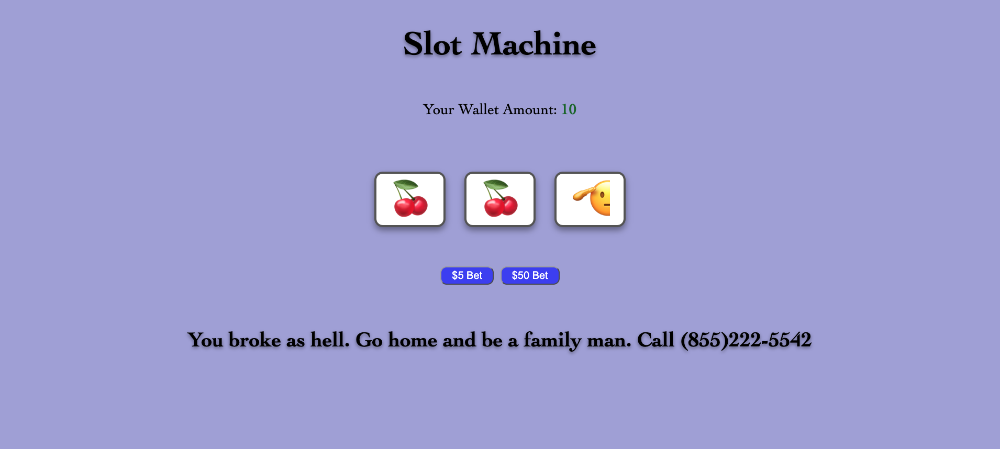

# 🎰 Slot Machine 🎰

### A simple browser-based slot machine game built with vanilla JavaScript. Spin three emoji reels, pick your bet, and watch your wallet go up or down.

[Visit Slot Machine](https://dontgambble.netlify.app/)

## Preview

## Features

- 3 reels, each landing on one of 5 random symbols (🍒 🍎 🍇 🫡 🎱)
- Start with a $100 wallet and choose a $5 or $50 bet
- Three matching symbols pays 3x your bet
- The last reel matching either of the first two pays 1.5x your bet
- Wallet balance and win/loss message update after every spin
- A message appears when you can't afford your bet

## Built With

- HTML, CSS, JavaScript (no frameworks or libraries)

## How to Play

1. Check your wallet at the top of the page.
2. Click **$5 Bet** or **$50 Bet** to spin the reels.
3. Match symbols to win. The result shows under the buttons.
4. Keep spinning until your wallet can't cover the bet.

## What I Learned

- Picking random items from an array with `Math.random()` to choose each reel's symbol
- Keeping track of game state (the wallet) in a variable and updating the page after each spin
- Selecting elements and responding to clicks with `querySelector` and event listeners
- Using one function for both bet buttons by passing the bet amount as an argument
